# Runtime Decision Tree

This flowchart follows a daemon-managed run from the 60-second heartbeat through scheduling, DDM resolution, reminder gates, dialog actions, and the next scheduled run.

```mermaid
flowchart TD
    Heartbeat([LaunchDaemon heartbeat<br/>RunAtLoad + 60 seconds]) --> MainExists{dor.zsh<br/>executable?}
    MainExists -->|No| StarterError[Log error and exit]
    MainExists -->|Yes| PID{dor.pid identifies<br/>active dor.zsh?}
    PID -->|Yes| StarterNoop[Quiet exit<br/>overlap prevented]
    PID -->|No or stale| ReadState[Read dor-state.plist<br/>NextScheduledReminder]
    ReadState --> Due{Schedule state}
    Due -->|FALSE| StarterNoop
    Due -->|Future| PostBoot{Console user logged in and<br/>no re-evaluation yet this boot?}
    PostBoot -->|No| StarterNoop
    PostBoot -->|Yes| StarterDarkWake
    Due -->|Due, empty, or invalid| StarterDarkWake{Maintenance DarkWake?<br/>pmset -g systemstate<br/>lacks Graphics}
    StarterDarkWake -->|Yes| StarterDefer[Log DarkWake NOTICE and exit<br/>scheduler state unchanged]
    StarterDarkWake -->|No| Trigger[Write DaemonLastTriggered and,<br/>with a console user, LastBootReevaluation<br/>launch dor.zsh as starter]

    Trigger --> Root{Running as root?}
    Root -->|No| FatalRoot[Fatal error]
    Root -->|Yes| User{Console user other than<br/>loginwindow, _mbsetupuser, or root?<br/>wait up to 120 seconds}
    User -->|No| FatalUser[Fatal error]
    User -->|Yes| Preferences[Load each preference<br/>Managed, then Local, then Default]

    Preferences --> Resolve[Resolve recent trusted DDM state<br/>from /var/log/install.log,<br/>corroborated by softwareupdate state]
    Resolve --> Status{Resolver status}
    Status -->|resolved| Requirement[Use confirmed DDM requirement]
    Status -->|missing, conflict,<br/>noMatch, invalidVersion| ReadFallback{Validated emergency<br/>fallback available?}
    Status -->|unknown| Suppress[Fail closed<br/>log suppression and exit]
    ReadFallback -->|No| Suppress
    ReadFallback -->|Yes| RequirementFallback[Use fallback requirement<br/>log selection]

    Requirement --> Compare{Installed macOS<br/>meets requirement?}
    RequirementFallback --> Compare
    Compare -->|Yes| Compliant[Quiet exit<br/>Mac compliant]
    Compare -->|No| Deadline[Resolve effective deadline<br/>safe padded date when correlated<br/>fallback uses supplied date]

    Deadline --> RestartMode[Evaluate optional post-deadline<br/>Prompt or Force restart mode]
    RestartMode --> Threshold[Evaluate next pre-deadline<br/>minute threshold]
    Threshold --> Aggressive[Evaluate aggressive mode<br/>deadline + configured hours<br/>unless kill switch exists]

    Aggressive --> PostBootRun{Post-boot<br/>re-evaluation run?}
    PostBootRun -->|No| Force
    PostBootRun -->|Yes| PostBootDue{Force, aggressive, or threshold<br/>due now, or stored schedule due?}
    PostBootDue -->|Yes| Force
    PostBootDue -->|No| SchedulePostBoot[Move NextScheduledReminder earlier<br/>for a threshold or aggressive start,<br/>never later, and exit]
    Force{Force restart<br/>mode active?}
    Force -->|Yes| DarkWake
    Force -->|No| ThresholdDue{Threshold reminder<br/>due now?}
    ThresholdDue -->|Yes| DarkWake
    ThresholdDue -->|No| Window{Inside display window?}
    Window -->|No| Periodic{Outside-window periodic<br/>reminder due?}
    Periodic -->|No| ScheduleBaseline[Schedule next baseline or threshold<br/>and exit]
    Periodic -->|Yes| UpdateTonight
    Window -->|Yes| UpdateTonight{Update Tonight confirmed today<br/>for target version, aggressive inactive,<br/>and deadline after midnight?}
    UpdateTonight -->|Yes| ScheduleTonight[Schedule first baseline slot<br/>after midnight or earlier threshold and exit]
    UpdateTonight -->|No| QuietBypass{Aggressive mode<br/>active?}
    QuietBypass -->|Yes| DarkWake
    QuietBypass -->|No| Quiet{Within interaction<br/>quiet period?}
    Quiet -->|Yes| ScheduleQuiet[Schedule exact quiet expiry<br/>or earlier threshold and exit]
    Quiet -->|No| Meeting{At least 36 hours remain<br/>and allowed meeting active?}
    Meeting -->|Yes| MeetingWait[Check every 5 minutes<br/>until clear or MeetingDelay reached]
    Meeting -->|No| DarkWake
    MeetingWait --> DarkWake{Maintenance DarkWake?<br/>no Graphics capability}
    DarkWake -->|Yes| ScheduleDarkWake[Schedule now + 60 seconds<br/>and exit]
    DarkWake -->|No| Build[Build localized dialog,<br/>icons with cached fallback,<br/>disk-space and battery warnings,<br/>and apply active mode]

    Build --> Mode{Dialog mode}
    Mode -->|Update| UpdateDialog[Standard, blur, urgent,<br/>or aggressive update dialog]
    Mode -->|Threshold| ThresholdDialog[Final-minute threshold dialog]
    Mode -->|Restart Prompt| PromptDialog[Restart-only prompt]
    Mode -->|Restart Force| ForceDialog[Restart-only timer dialog]

    UpdateDialog --> Display[Display swiftDialog]
    ThresholdDialog --> Display
    PromptDialog --> Display
    ForceDialog --> Display

    Display --> ForceReturn{Force mode?}
    ForceReturn -->|Yes| RestartReturn{Return 0 or 4?}
    RestartReturn -->|Yes| Restart[Issue restart command]
    RestartReturn -->|No| ForceRedisplay[Wait configured seconds<br/>and redisplay in same run]
    ForceRedisplay --> Display

    ForceReturn -->|No| Return{Dialog return}
    Return -->|Open Software Update| SoftwareUpdate[Open System Settings as console user<br/>wait up to 30 seconds for launch]
    Return -->|Restart Now| Restart
    Return -->|Remind Me Later| Postpone[Record interaction]
    Return -->|Info| Info[Open support action<br/>as console user]
    Return -->|Dismiss, DND, timeout,<br/>keyboard quit, other| Dismiss[Record result]

    SoftwareUpdate --> NextSchedule
    Postpone --> NextSchedule
    Info --> InfoRedisplay{Secondary button<br/>hidden or disabled?}
    InfoRedisplay -->|Yes| InfoWait[Wait 61 seconds<br/>and redisplay]
    InfoWait --> Display
    InfoRedisplay -->|No| NextSchedule
    Dismiss --> NextSchedule{Aggressive mode active?}
    NextSchedule -->|Yes| ExactAggressive[Schedule now +<br/>AggressiveModeFrequencyMinutes]
    NextSchedule -->|No| NormalSchedule[Schedule quiet expiry,<br/>threshold, or baseline]

    style Heartbeat fill:#e3f2fd
    style StarterNoop fill:#cfd8dc
    style StarterDefer fill:#cfd8dc
    style Trigger fill:#e1f5ff
    style Status fill:#ffecb3
    style ReadFallback fill:#ffe0b2
    style Suppress fill:#cfd8dc
    style Compliant fill:#cfd8dc
    style Aggressive fill:#ffcc80
    style Build fill:#fff9c4
    style Display fill:#81c784
    style FatalRoot fill:#ef5350
    style FatalUser fill:#ef5350
    style Restart fill:#ffcdd2
```

## Scheduler Decisions

- `dor.pid` prevents overlap. A stale or malformed PID is removed without terminating unrelated processes.
- `NextScheduledReminder=FALSE` disables daemon-driven reminders.
- A future `NextScheduledReminder` produces an expected quiet no-op, with one exception: after each boot, the first heartbeat that finds a console user other than `loginwindow`, `_mbsetupuser`, or `root` launches `dor.zsh` once to re-evaluate the deadline, because macOS may re-pad a past-due deadline at login. The starter records the boot in `LastBootReevaluation` (the `kern.boottime` epoch) and logs `[NOTICE] Starter launch after boot; re-evaluating deadline …`. That run shows a reminder only when a threshold, aggressive mode, or Force mode is due; otherwise it moves `NextScheduledReminder` earlier for a pending threshold or aggressive-mode start (never later) and exits with `No reminder shown: post-boot re-evaluation found no reminder due`.
- Due, empty, missing, or invalid scheduler state causes the starter to run the full workflow so it can repair or advance scheduling.
- Starting with `5.3.0b4`, a heartbeat during a Maintenance DarkWake (`pmset -g systemstate` lists `CPU` but not `Graphics`) does not launch `dor.zsh`, even when a reminder is due. The starter logs `[NOTICE] DarkWake detected (system capabilities: …); deferring reminder launch to the next heartbeat.` and leaves `dor-state.plist` unchanged, including `LastBootReevaluation`, so the due reminder (or post-boot re-evaluation) runs on the first heartbeat after a full wake. Unrecognized `pmset` output fails open and launches as before.
- Manual and demo runs bypass scheduler writes; only starter-launched runs own `dor.pid` and mutate `dor-state.plist`.

## DDM and Fallback Decisions

Normal DDM resolution always runs first. When the root-owned `/var/db/softwareupdate/SoftwareUpdateDDMStatePersistence.plist` is readable, only `install.log` declarations matching one of its active declarations (`TargetOSVersion` and `TargetLocalDateTime`) are considered; the others are ignored and logged at `[WARNING]`. When the file is missing or unrecognized, resolution trusts uncorroborated `install.log` declarations for backward compatibility and logs a `[WARNING]`.

- `resolved`: confirmed DDM wins and persisted fallback stays inactive.
- `missing`, `conflict`, `noMatch`, or `invalidVersion`: runtime may select a valid emergency fallback.
- Exception (`5.3.0b5` and later): a `conflict` caused only by a leftover declaration the Mac already meets (`No updates found for DDM to enforce` logged after it) skips fallback and ends with `No reminder shown: macOS <installed> already meets DDM-enforced macOS <version>; softwareupdated has nothing left to enforce`.
- Missing, corrupt, incomplete, wrong-type, or invalid fallback data preserves the original suppression result.
- Unknown resolver states fail closed without fallback selection.

Fallback metadata changes reminder inputs only. It does not download an update, create Apple enforcement, or replace DDM.

## Reminder Timing Decisions

Scheduling combines four sources:

1. **Baseline slots** from `DailyReminderTimes`.
2. **Final-minute thresholds** from `MinutesBeforeDeadlineReminderSchedule`.
3. **Interaction quiet period** from `QuietPeriodMinutes`, measured from user interaction rather than initial dialog display.
4. **Aggressive cadence** from `AggressiveModePastDeadlineHours` and `AggressiveModeFrequencyMinutes` after the effective deadline.

The earliest applicable exact time wins. Threshold reminders bypass quiet-period suppression. Force restart mode bypasses quiet-period and meeting checks.

No mode bypasses the Maintenance DarkWake check, because nobody can see a dialog drawn during DarkWake. A run that reaches the dialog during DarkWake (for example, after a `MeetingDelay` wait) schedules an exact retry 60 seconds later (starter-launched runs only) and logs `[NOTICE] No reminder shown: the Mac is in a Maintenance DarkWake …`, so threshold, aggressive, and Force reminders appear at the first full wake instead of moving to a later baseline slot.

**Update Tonight suppression** is runtime-only and has no preference key. When `/var/log/install.log` shows lines logged by `softwareupdated` itself confirming that it queued the required version (`SUOSUInstallTonightManager: Queued … macOS <version>`) and armed the scheduler (`SUOSUScheduler: ARMED (… simulated=NO)`), normal reminders stop until local midnight. The evidence must be from today, newer than the last boot, and not followed by a disarm, dequeue, or `enabled = false` line. The next run is scheduled for the first `DailyReminderTimes` slot after midnight, or for an earlier pending threshold or aggressive-mode start (effective deadline plus `AggressiveModePastDeadlineHours`, kill switch absent). Threshold, aggressive, and Force reminders bypass this suppression, and it never applies when the effective deadline is at or before local midnight. Daemon runs record the expiry as `UpdateTonightSuppressionUntil` in `dor-state.plist` and log it as expired or cleared on the next run.

## Dialog Modes

| Mode | Activation | Result |
|------|------------|--------|
| Standard | Inside display window, before blur threshold | Normal dialog, Button 2 available |
| Blur | Inside blur window | Blurscreen, Button 2 available |
| Urgent | At or inside hide-button threshold | Blurscreen, Button 2 disabled or hidden |
| Threshold | Configured final-minute threshold due | Threshold-specific copy; delivered once per declaration signature |
| Aggressive | Past effective deadline by configured hours | Update-focused copy and exact redisplay cadence |
| Restart Prompt | Optional restart workflow eligible | Restart-only prompt |
| Restart Force | Optional force workflow eligible | Timer plus same-run redisplay until restart |

## Observable Exit Paths

Every meaningful branch logs through the existing structured log format. Common quiet exits include active PID, future or disabled schedule, unresolved requirement without valid fallback, compliance, outside-window suppression, Update Tonight suppression, active quiet period, Maintenance DarkWake deferral, and DND/Focus return. Use `dor-state.plist` before treating a heartbeat no-op as failure.

Starting with `5.2.0`, client-log entries name the outcome and the next step:

- `DDM update check: <outcome> (status=…; source=…; reason=…)` records what the resolver decided on that Mac.
- Every run that shows no reminder ends with `No reminder shown: …` and `Next step: …`. `missing` and up-to-date outcomes log at `[NOTICE]`; `conflict`, `noMatch`, `invalidVersion`, and unrecognized states log at `[WARNING]`.
- Display-window, periodic, Update Tonight, quiet-period, and meeting exits log `[QUIT] No reminder shown: …`, naming the controlling preference and when the reminder returns.
- Fatal exits (not running as root, overlapping run, no console user, missing swiftDialog) include a next step.
- Each displaying run logs `[INFO] Disk space: …` and `[NOTICE] Battery: …` lines showing whether each warning was shown.
