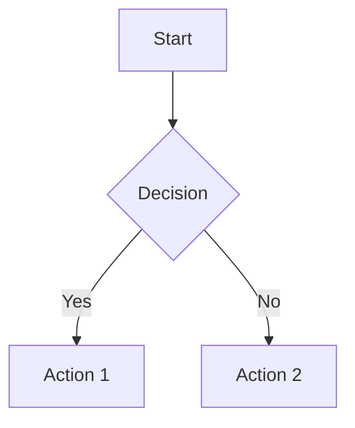
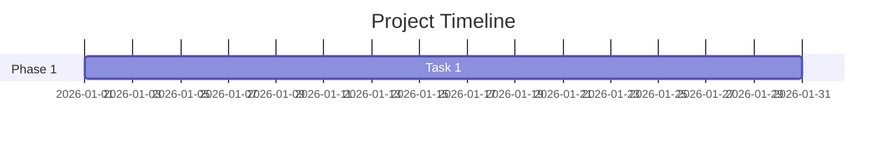
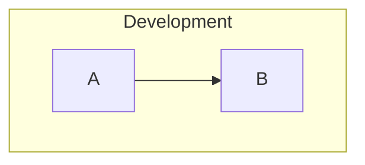
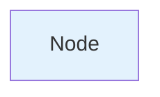

# DDM OS Reminder (5.2.0) - Documentation Diagrams

This directory contains comprehensive, **AI-generated** visual diagrams to augment the DDM OS Reminder documentation at [snelson.us/ddm](https://snelson.us/ddm).

## 📊 Available Diagrams

### 1. [Executive Overview](00-overview.md)
**Purpose**: High-level lifecycle view for Mac Admins who need the big picture first

**Shows**:
- Assemble → MDM → client scheduler → reminder → Software Update → compliance
- Quiet compliance exits and the next-declaration cycle
- Administrator, reminder-runtime, and Apple update ownership boundaries

**Best For**: Rapid orientation and stakeholder-friendly explanations

---

### 2. [System Architecture](01-system-architecture.md)
**Purpose**: Complete ecosystem overview from development through runtime execution

**Shows**:
- Development environment components
- Three assembly inputs and three deployable outputs
- Either-or `.plist` / `.mobileconfig` preference deployment
- Client heartbeat, starter, state, PID guard, fallback, and support suppression assets
- Private per-run swiftDialog files and softwareupdate DDM state corroboration
- Apple-owned update and enforcement path

**Best For**: Understanding how all components fit together

---

### 3. [Runtime Decision Tree](02-runtime-decision-tree.md)
**Purpose**: Complete decision logic executed each time the heartbeat daemon and `dor-starter.zsh` decide a run is due

**Shows**:
- Starter PID and due-time checks
- User validation checks
- Trusted DDM resolver, emergency fallback, and effective deadline evaluation
- Version comparison logic
- Baseline, threshold, quiet-period, and aggressive scheduling
- Dialog modes and user interaction outcomes

**Best For**: Understanding script behavior and troubleshooting

---

### 4. [Deadline Timeline](03-deadline-timeline.md)
**Purpose**: Visual representation of how user experience and scheduler behavior change as deadline approaches

**Shows**:
- Client-side coordination through `dor-state.plist`
- Phase 1: Outside display window
- Phase 2: Standard reminders (early warning)
- Phase 3: Blurscreen warnings (escalating urgency)
- Phase 4: Urgent and final-minute reminders
- Phase 5: Post-deadline aggressive/restart workflow
- Phase 6: Apple DDM enforcement

**Best For**: Understanding deadline-driven behavior changes

---

### 5. [Deployment Workflow](04-deployment-workflow.md)
**Purpose**: Step-by-step guide for administrators deploying DDM OS Reminder

**Shows**:
- DDM and non-production test prerequisites
- Source demo and preference preview
- Interactive, prior-plist, or prior-mobileconfig assembly
- Either-or preference artifact deployment followed by one-time script execution
- Heartbeat verification and expected no-op behavior
- Pilot, production, monitoring, and upgrade paths

**Best For**: Implementation and deployment planning

---

### 6. [Configuration Hierarchy](05-configuration-hierarchy.md)
**Purpose**: 3-tier preference system showing precedence rules

**Shows**:
- Per-key `Managed → Local → Default` resolution
- Localization fallback after preference loading
- Separation of administrator preferences from scheduler state
- Emergency fallback and aggressive kill-switch boundaries

**Best For**: Understanding configuration management and customization

---

### 7. [Configuration Reference](06-configuration-reference.md)
**Purpose**: Complete reference for all 77 base configurable preferences and their localized families

**Shows**:
- Quick reference table (all variables at a glance)
- Detailed documentation by category
- Complete placeholder reference
- Configuration methods and examples
- Common deployment scenarios
- Troubleshooting guide

**Best For**: Customizing DDM OS Reminder, looking up specific variables

**Note**: Text reference only (no Mermaid diagram to render)

---

## 🎨 Rendering Diagrams

All diagrams `00`–`05` use **Mermaid.js** syntax for maximum portability and version control. The configuration reference (06) is text-only and does not export to an image.

### View on GitHub
Mermaid blocks render automatically on GitHub inside `.md` files. Text-only files render as standard Markdown.

**Direct viewing**:
```
https://github.com/dan-snelson/DDM-OS-Reminder/blob/main/Diagrams/00-overview.md
```

### Render Locally

#### Option 1: VS Code with Mermaid Extension
1. Install [Mermaid Preview Extension](https://marketplace.visualstudio.com/items?itemName=bierner.markdown-mermaid)
2. Open any diagram `.md` file
3. Press `Cmd+Shift+V` (macOS) or `Ctrl+Shift+V` (Windows/Linux)

#### Option 2: Mermaid Live Editor
1. Copy Mermaid code from any diagram
2. Open [Mermaid Live Editor](https://mermaid.live/)
3. Paste code and view rendered diagram
4. Export as SVG, PNG, or PDF

#### Option 3: Mermaid CLI
```bash
# Install Mermaid CLI
npm install -g @mermaid-js/mermaid-cli

# Render to PNG
mmdc -i 00-overview.md -o 00-overview.png

# Render to SVG
mmdc -i 00-overview.md -o 00-overview.svg

# Render all Mermaid diagrams (00–05)
for file in 0[0-5]-*.md; do
    mmdc -i "$file" -o "${file%.md}.png"
done
```

### Export for Documentation Website

#### As PNG Images (Recommended for blog posts)
```bash
# High resolution PNG (300 DPI)
mmdc -i 00-overview.md -o 00-overview.png -w 2400

# Standard resolution
mmdc -i 00-overview.md -o 00-overview.png
```

#### As SVG (Recommended for scaling)
```bash
mmdc -i 00-overview.md -o 00-overview.svg
```

#### Embed in Markdown
```markdown
<!-- Mermaid (renders on GitHub) -->
~~~mermaid
graph TD
    A --> B
~~~

<!-- Image (works everywhere) -->

```

#### Embed in HTML
```html
<!-- Mermaid.js library -->
<script src="https://cdn.jsdelivr.net/npm/mermaid/dist/mermaid.min.js"></script>
<script>mermaid.initialize({startOnLoad:true});</script>

<!-- Diagram -->
<div class="mermaid">
graph TD
    A --> B
</div>
```

---

## 📝 Diagram Format

### File Naming Convention
```
[number]-[descriptive-name].md

Examples:
00-overview.md
01-system-architecture.md
02-runtime-decision-tree.md
03-deadline-timeline.md
```

PNG and SVG exports mirror the `.md` base name (for example, `01-system-architecture.png` and `01-system-architecture.svg`). Files with more than one Mermaid block add a numeric suffix from the second block onward (for example, `03-deadline-timeline-2.png`).

### Markdown Structure
```markdown
# [Diagram Title]

[Brief description of diagram purpose]

## Mermaid Diagram

```mermaid
[Mermaid syntax here]
```

## Detailed Explanation

[Text explanation of diagram components, decision points, etc.]

## Configuration

[Related configuration options, if applicable]

## Examples

[Practical examples showing how to use/interpret the diagram]
```

---

## 🎯 Usage Recommendations

### For Blog Post / Documentation Website

1. **Executive Summary Section**: Use [Executive Overview](00-overview.md)
   - Place after introduction, before features
   - Helps readers understand the lifecycle at a glance

2. **Architecture Section**: Use [System Architecture](01-system-architecture.md)
   - Use immediately after executive overview
   - Provides full component and integration detail

3. **Features Section**: Use [Deadline Timeline](03-deadline-timeline.md)
   - Illustrates key differentiating feature (deadline-driven behavior)
   - Visual progression from early warnings to urgent messages

4. **Implementation Section**: Use [Deployment Workflow](04-deployment-workflow.md)
   - Step-by-step visual guide for administrators
   - Can link to detailed subsections

5. **Advanced Configuration Section**: Use [Configuration Hierarchy](05-configuration-hierarchy.md)
   - Shows 3-tier preference system
   - Helps admins understand customization options

6. **Troubleshooting Section**: Use [Runtime Decision Tree](02-runtime-decision-tree.md)
   - Shows all decision points and exit conditions
   - Helps diagnose why script may/may not display dialog
   - Uploaded client logs, `install.log`, and preference plists: [Diagnose client state](../Resources/README.md#7-diagnose-client-state)

### For README.md

Embed key diagrams inline:
```markdown
## How It Works


DDM OS Reminder follows a simple lifecycle from build to enforcement...

## System Architecture


DDM OS Reminder consists of three main components...

## Deployment


Follow these steps to deploy DDM OS Reminder...
```

### For Presentations

Export diagrams as high-resolution PNG or SVG:
```bash
# 4K resolution for presentations
mmdc -i 00-overview.md -o 00-overview.png -w 3840 -h 2160
```

---

## 🔧 Customizing Diagrams

### Editing Mermaid Syntax

Each diagram uses standard Mermaid syntax. Key elements:

**Flowchart**:


**Gantt Chart** (Timeline):


**Subgraphs** (Grouping):


**Styling**:


### Color Scheme

Current diagrams use consistent color coding:

| Color | Hex | Purpose |
|-------|-----|---------|
| Light Blue | `#e3f2fd` | Start/End nodes |
| Yellow | `#fff9c4` | Processing/Setup |
| Purple | `#e1bee7` | Development files |
| Green | `#c8e6c9` | Success/Artifacts |
| Orange | `#ffecb3` | MDM/External systems |
| Red | `#ef5350` | Errors/Critical |
| Gray | `#cfd8dc` | Exit points |

### Maintaining Consistency

When creating new diagrams:
1. Use established color scheme
2. Follow naming convention
3. Include both diagram and detailed explanation
4. Provide configuration context
5. Add practical examples

---

## 📐 Diagram Specifications

### Technical Details

| Specification | Value |
|---------------|-------|
| **Format** | Mermaid.js (text-based) |
| **Version** | Compatible with Mermaid 9.x+ |
| **Encoding** | UTF-8 |
| **Line Endings** | LF (Unix) |
| **Max Width** | 2400px (for export) |
| **Max Height** | Unlimited (auto) |

### Export Recommendations

| Use Case | Format | Resolution | Notes |
|----------|--------|------------|-------|
| Blog post | PNG | 1200-2400px | Balance size vs. quality |
| Documentation | SVG | Vector | Scales perfectly |
| Presentation | PNG | 3840px | 4K resolution |
| Print | PDF | Vector | Best for printing |
| GitHub | Markdown | Native | Renders automatically |

---

## 🚀 Quick Start

### View All Diagrams Quickly

```bash
# Clone repository
git clone https://github.com/dan-snelson/DDM-OS-Reminder.git
cd DDM-OS-Reminder/Diagrams

# Open in VS Code with Mermaid extension
code .

# Or open in GitHub (renders automatically)
open https://github.com/dan-snelson/DDM-OS-Reminder/tree/main/Diagrams
```

### Export for Website

```bash
# Install Mermaid CLI (one-time)
npm install -g @mermaid-js/mermaid-cli

# Export all diagrams as PNG
for file in 0[0-5]-*.md; do
    echo "Rendering $file..."
    mmdc -i "$file" -o "../images/${file%.md}.png" -w 2400
done

echo "All diagrams exported to ../images/"
```

### Update Diagrams

1. Edit `.md` file with Mermaid syntax changes
2. Preview in VS Code or Mermaid Live Editor
3. Export updated image if needed
4. Commit changes to version control

---

## 🤝 Contributing

### Adding New Diagrams

1. Create new `.md` file with next sequential number
2. Follow established format (title, diagram, explanation)
3. Use consistent color scheme
4. Update this README with new diagram description
5. Submit pull request

### Improving Existing Diagrams

1. Edit relevant `.md` file
2. Test rendering in multiple viewers
3. Update associated documentation if needed
4. Submit pull request with clear description of changes

---

## 📚 Resources

### Mermaid Documentation
- [Official Docs](https://mermaid.js.org/)
- [Flowchart Syntax](https://mermaid.js.org/syntax/flowchart.html)
- [Gantt Syntax](https://mermaid.js.org/syntax/gantt.html)
- [Styling](https://mermaid.js.org/config/theming.html)

### Tools
- [Mermaid Live Editor](https://mermaid.live/) - Online editor
- [VS Code Extension](https://marketplace.visualstudio.com/items?itemName=bierner.markdown-mermaid) - Preview in editor
- [Mermaid CLI](https://github.com/mermaid-js/mermaid-cli) - Export to images

### Examples
- [Mermaid Examples](https://mermaid.js.org/ecosystem/integrations.html)
- [GitHub Markdown Support](https://github.blog/2022-02-14-include-diagrams-markdown-files-mermaid/)

---

## 📞 Support

**Questions or Issues with Diagrams?**

- **GitHub Issues**: [DDM-OS-Reminder/issues](https://github.com/dan-snelson/DDM-OS-Reminder/issues)
- **Mac Admins Slack**: [#ddm-os-reminders](https://slack.com/app_redirect?channel=C09LVE2NVML) Channel
- **Documentation**: [snelson.us/ddm](https://snelson.us/ddm)

---

## 📄 License

These diagrams are part of the DDM OS Reminder project and follow the same license.

See [LICENSE](../LICENSE) file for details.

---

## ✨ Acknowledgments

Created to augment the comprehensive DDM OS Reminder documentation.

**Author**: Dan K. Snelson ([@dan-snelson](https://github.com/dan-snelson))

**Website**: [snelson.us/ddm](https://snelson.us/ddm)

---

## 📝 Version History

| Version | Date | Changes |
|---------|------|---------|
| 1.0.27 | 27-Oct-2026 | `5.3.0b5`: 02 and 05 note that a `conflict` from a leftover declaration the Mac already meets skips DDM Emergency Fallback; prose only, no PNG/SVG changes |
| 1.0.26 | 26-Oct-2026 | `5.3.0b4` pre-release review: 02 notes the 60-second DarkWake retry applies to starter-launched runs only; 04 and 06 add the `dor-icon-*` cache to the files `All` / `Script` keep and `Uninstall` removes; 06 adds the `SwapOverlayAndLogo` no-overlay rule, notes the reachability wait checks the macOS icon host, and adds a `5.3.0b4` Version History row; prose only, no PNG/SVG changes |
| 1.0.25 | 26-Oct-2026 | Documented the `5.3.0b4` Maintenance DarkWake deferral and branding-icon fallback ([Issue #172](https://github.com/dan-snelson/DDM-OS-Reminder/issues/172)): 02 adds the starter DarkWake exit and the runtime DarkWake check before dialog build (60-second exact retry; no mode bypasses it); 04 adds the starter DarkWake bullet; 06 documents overlay download retry, the `dor-icon-overlay-*` cache, and no-overlay fallback; re-rendered `02-runtime-decision-tree` PNG/SVG exports with `mmdc` 12.0.0, which also picks up the `5.3.0b2` post-boot changes |
| 1.0.24 | 22-Oct-2026 | Documented the `5.3.0b3` lane-marker normalization for prior-plist / prior-profile import ([Issue #168](https://github.com/dan-snelson/DDM-OS-Reminder/issues/168)): 04 notes that promoting a dev or test file needs `--lane prod` and that imported values starting with `Assembled`, `Sample`, or `TEST` are rewritten to match the selected lane |
| 1.0.23 | 22-Oct-2026 | Documented the `5.3.0b2` post-boot re-evaluation ([Issue #165](https://github.com/dan-snelson/DDM-OS-Reminder/issues/165)): 02 adds the starter's once-per-boot branch (console user present, `LastBootReevaluation` not yet this boot) and the runtime's reschedule-only gate; 03/04 replace "a future `NextScheduledReminder` survives reboot and `RunAtLoad` exits quietly" with the once-per-boot exception; 05/06 list `LastBootReevaluation` as runtime-only scheduler state; `02-runtime-decision-tree` PNG/SVG exports still need re-rendering with `mmdc` |
| 1.0.22 | 21-Oct-2026 | Updated the 03 scheduler rules for `5.3.0b1`: the aggressive-mode start becomes the exact `NextScheduledReminder` when it comes before the next baseline or quiet-period time ([Issue #164](https://github.com/dan-snelson/DDM-OS-Reminder/issues/164)); noted the same candidate in the 02 Update Tonight scheduling prose and the 06 `AggressiveModePastDeadlineHours` behavior; noted in 03/06 that `PreDeadlineThresholdDelivered` records a threshold only after a user-interaction return code or an open-dialog refresh; no Mermaid source changes, so PNG/SVG exports were not re-rendered |
| 1.0.21 | 20-Oct-2026 | Corrected the meeting-deferral window in 02/03/06: `MeetingDelay` applies only when at least 36 hours remain (rounded days remaining greater than `1`), not 24 hours; relabeled the 03 gantt milestone `Restart Eligible (if enabled)` because `PastDeadlineRestartBehavior` defaults to `Off`; re-rendered `02-runtime-decision-tree` and `03-deadline-timeline` PNG/SVG exports |
| 1.0.20 | 20-Oct-2026 | Reconciled diagrams with `5.2.0` runtime truth: 77 base preference keys in 05/README; disk-space and battery warnings in the 02 dialog-build step; `DDM update check:`, `No reminder shown:`, and `Next step:` log wording in 02/06; `{minutesBeforeDeadline}` behavior in 03; prior `.mobileconfig` import and a `5.2.0` upgrade section in 04; corrected 06 defaults (`title`, `preDeadlineThresholdTitle`, `infobox`), placeholder table (10 missing placeholders), localized families, language-selection gating, Knowledge Base assembly note, and troubleshooting tips; expanded the 06 `5.2.0` history row and added the missing `5.1.0` row; re-rendered `02`, `04`, and `05` PNG/SVG exports with `mmdc` 12.0.0 (`04` exports had predated its `5.2.0` Mermaid change) |
| 1.0.19 | 20-Oct-2026 | Updated the `{minutesBeforeDeadline}` description in 06 for `5.2.0` (minutes remaining, rounded up, capped at the crossed threshold); no Mermaid source changes, so PNG/SVG exports were not re-rendered |
| 1.0.18 | 18-Oct-2026 | Documented the `5.2.0` low-battery warning (`MinimumBatteryPercentage`, `BatteryWarningMessage`, `{batteryWarningMessage}`, `{batteryPercentage}`) in 03/06; corrected 03 to say the low-disk-space warning is suppressed in restart-only mode while the low-battery warning is kept; no Mermaid source changes, so PNG/SVG exports were not re-rendered |
| 1.0.17 | 16-Oct-2026 | Raised `MinimumDiskFreeGB` sample default from `26` to `35` in 06 after a 26.60 GB fully staged update was observed |
| 1.0.16 | 12-Oct-2026 | Aligned prose with `5.1.0`: `MinimumDiskFreeGB` replaces deprecated `MinimumDiskFreePercentage` in 03/06, and `Uninstall` alone removes `dor-state.plist` (kept by `All` / `Script`) in 04; no Mermaid source changes, so PNG/SVG exports were not re-rendered |
| 1.0.15 | 04-Oct-2026 | Reconciled diagrams with `5.0.0` runtime truth: softwareupdate DDM state corroboration, private per-run `/var/tmp` files, app-bundle `dialogcli`, console-user exclusions (`_mbsetupuser`, `root`), bounded System Settings wait, atomic script deployment, self-extracting parameter forwarding, kill-switch preservation on `All` / `Script`, and language-code hardening; restored PNG and SVG exports for `00`–`05` (rendered with `mmdc` 12.0.0, including the second `03` timeline diagram) |
| 1.0.14 | 21-Sep-2026 | Refreshed lifecycle, assembly, heartbeat, scheduler, MDM-agnostic deployment, configuration-boundary, and upgrade diagrams from the JNUC 2026 workflow; reconciled all content with `4.2.0` runtime truth |
| 1.0.13 | 30-Jul-2026 | Added macOS 27 LaunchDaemon quarantine audit, targeted remediation, and label-specific verification guidance |
| 1.0.12 | 28-Jul-2026 | Documented `PreDeadlineThresholdSignature` structure, `(null)` build semantics, effective-enforcement epoch, threshold delivery/skipped ledger resets, and runtime-only troubleshooting guidance |
| 1.0.11 | 10-Jul-2026 | Clarified quiet-period scheduling when baseline daemon runs occur before `QuietPeriodMinutes` expires, including exact `NextScheduledReminder` behavior after prior Button 1 interaction |
| 1.0.10 | 08-Jul-2026 | Clarified `NextScheduledReminder` runtime behavior after reboot: future-dated scheduler state survives reboot and `RunAtLoad` exits quietly until due |
| 1.0.9 | 08-Jul-2026 | Updated daemon/scheduling diagrams for the v4 heartbeat `dor-starter.zsh` flow, `dor.zsh` deployed path, runtime state assets, and `DailyReminderTimes`-driven baseline reminder slots |
| 1.0.8 | 08-Jul-2026 | Refreshed configuration-reference coverage for explicit lowercase placeholder variants, the natural Japanese deadline-format override example, and current German `macOS-Update` sample wording |
| 1.0.7 | 14-May-2026 | Documented region-aware deadline date-format fallback keys, exact/base locale resolution behavior, and aligned relative-deadline time rendering guidance |
| 1.0.6 | 06-Apr-2026 | Refreshed diagram documentation for the `3.2.0` release, including final-version metadata, current localization behavior, `VersionString`-based compliance fallback when `BuildVersionString` is unavailable, and bundled EA fixture-hook guidance |
| 1.0.5 | 28-Mar-2026 | Updated overview, deployment workflow, and configuration reference markdown for `3.0.0` prior-plist upgrade-assist, lane-suffixed artifact names, and `2.2.0+` documented compatibility |
| 1.0.4 | 25-Mar-2026 | Updated runtime and deployment diagrams for the hardened DDM resolver, corrected `dorm.zsh` client-script paths, refreshed EA documentation, and converted 00-overview source to Mermaid |
| 1.0.3 | 05-Mar-2026 | Added 00 Executive Overview diagram and PNG export; renumbered diagram index and updated rendering guidance for 00–05 |
| 1.0.2 | 01-Mar-2026 | Updated staged-update documentation in 02/06 for proposed metadata validation and pending-download normalization behavior |
| 1.0.1 | 05-Feb-2026 | Regenerated PNG exports for 01–05 with filename parity to `.md` sources |
|       |            | - Removed legacy `*-1.png` files |
|       |            | - Clarified 06 configuration reference is text-only |
| 1.0.0 | 19-Jan-2026 | Initial diagram collection created |
|       |            | - System Architecture |
|       |            | - Runtime Decision Tree |
|       |            | - Deadline Timeline |
|       |            | - Deployment Workflow |
|       |            | - Configuration Hierarchy |

---

**Last Updated**: 26-Oct-2026
**DDM OS Reminder Version**: 5.2.0
