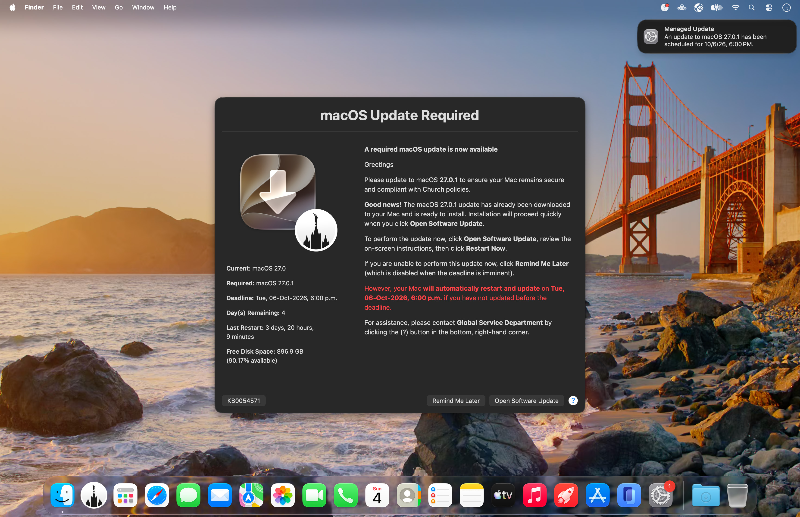
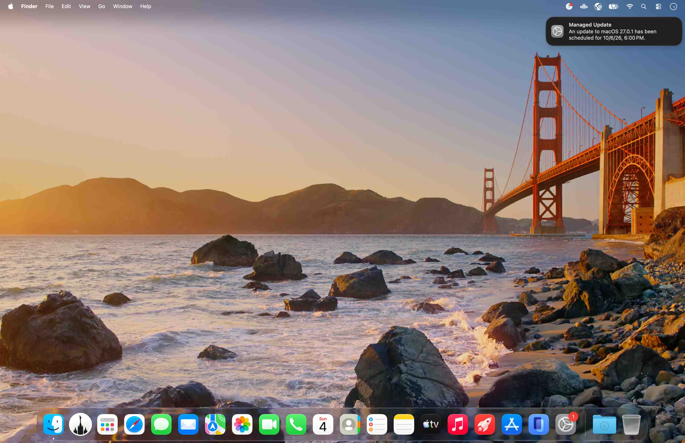
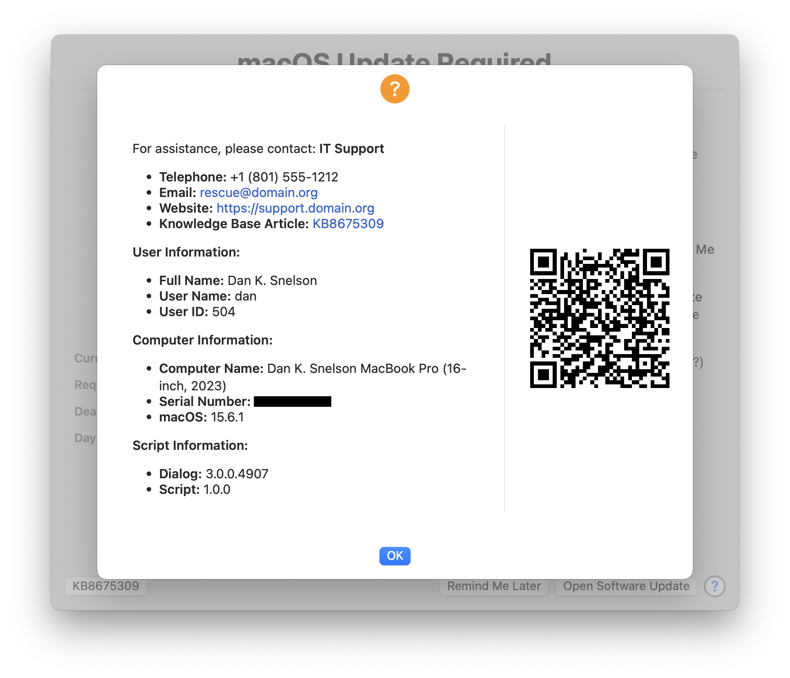
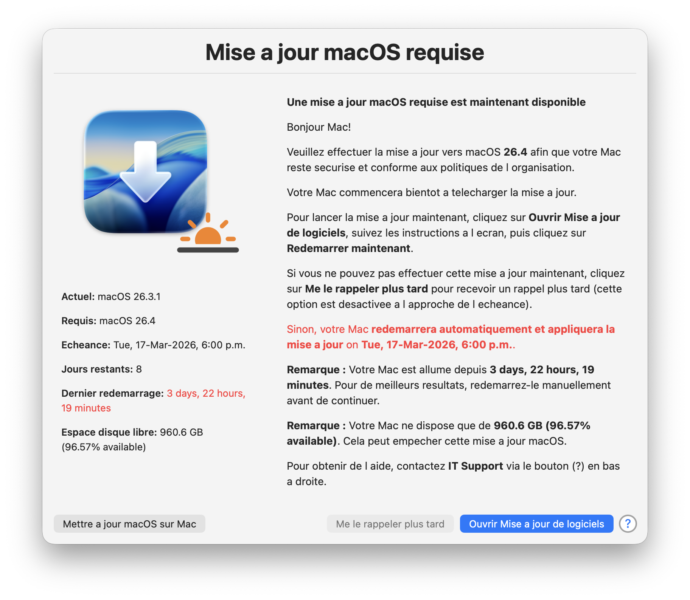
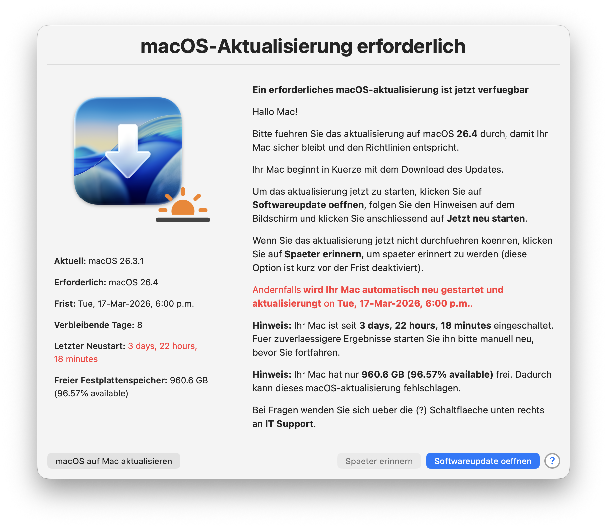
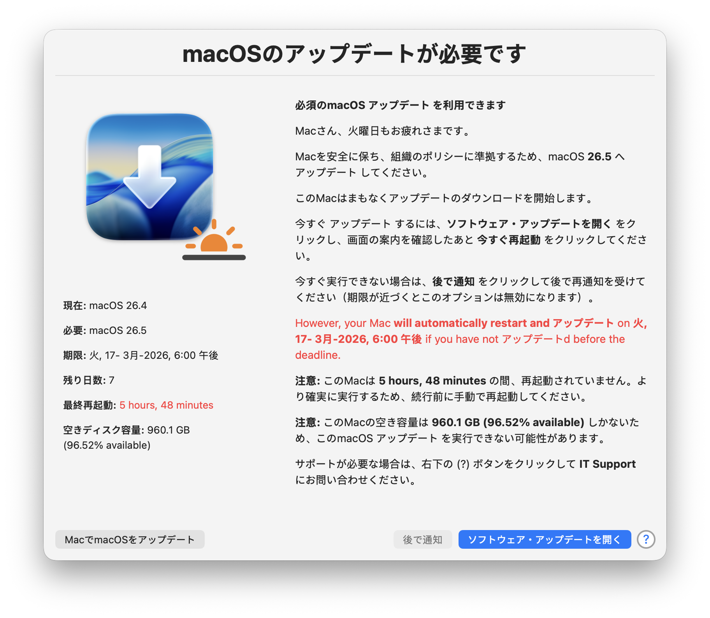
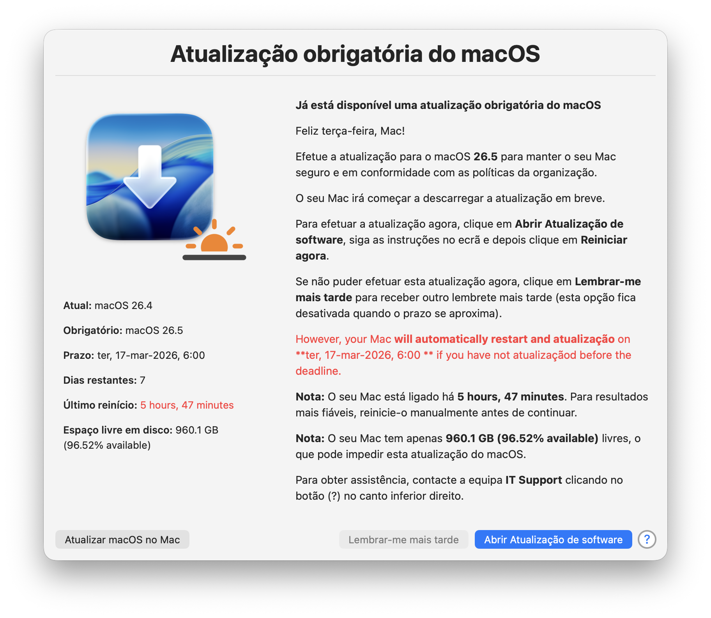
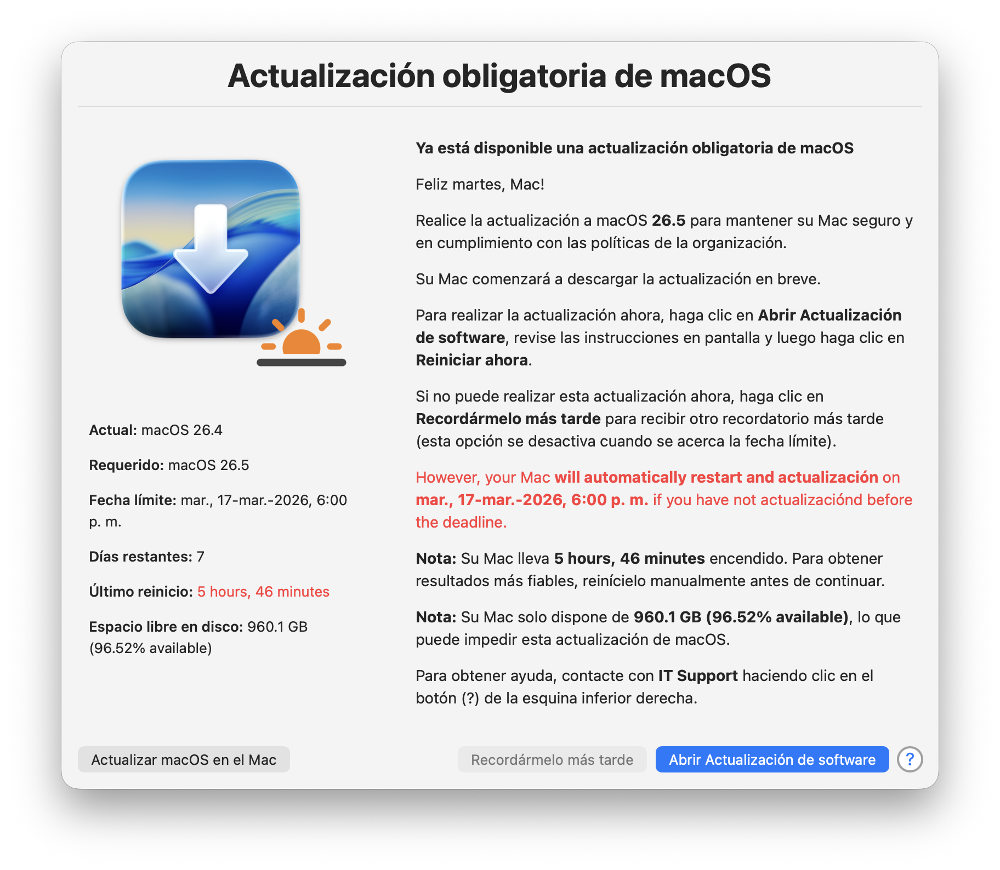
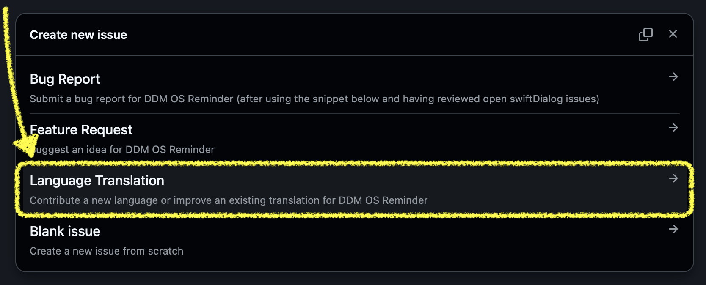

      [](https://swiftdialog.app) [](https://semgrep.dev)

# DDM OS Reminder (5.3.0b4)

> Another welcome tune-up to Mac Admins' favorite "set-it-and-forget-it" macOS update reminder, featuring a **low-battery warning**, **plain-language** client-side logs (with clear next steps), and re-assembly from **hand-edited** Configuration Profiles



## Overview

While Apple’s Declarative Device Management (DDM) provides Mac Admins with a powerful way to _enforce_ macOS updates, its built-in notification is often _too subtle_ for most administrators:
<br/>
 

**DDM OS Reminder** intelligently resolves DDM-enforced macOS update deadlines from recent `/var/log/install.log` activity, while using a declaration-aware resolver which prioritizes applicable enforced-install signals. Normal DDM resolution always runs first, and a confirmed declaration wins; when the root-owned `SoftwareUpdateDDMStatePersistence.plist` is readable, `install.log` declarations must also match an active declaration persisted by `softwareupdated`. When resolution returns `missing`, `conflict`, `noMatch`, or `invalidVersion`, an optional validated DDM Emergency Fallback can keep reminder workflows active; absent or invalid fallback data preserves fail-safe suppression, and unknown resolver states always fail closed. Failed stale `SoftwareUpdateSubscriber` attempts are ignored, and enforcement timestamps with full timezone offsets such as `+05:30` are accepted before using a [swiftDialog](https://swiftdialog.app)-enabled script and `LaunchDaemon` to deliver a more prominent end-user reminder dialog.




---

## Features

- **Customizable**: Easily customize the reminder dialog’s title, message, icons (including light/dark overlay icons) and button text to fit your organization’s requirements by distributing a Configuration Profile via any MDM solution.
- **Easy Installation**: The [assemble.zsh](assemble.zsh) script makes it easy to deploy your reminder dialog and display frequency customizations via any MDM solution, enabling quick rollout of DDM OS Reminder organization-wide.
- **Set-it-and-forget-it**: Once configured and installed, a heartbeat `LaunchDaemon` plus lightweight `dor-starter.zsh` honors your configured `DailyReminderTimes` baseline schedule and displays your customized reminder dialog only when a reminder is actually due.
- **Deadline Awareness**: Whenever a DDM-enforced macOS version or its deadline is updated via your MDM solution, the reminder dialog dynamically updates the countdown to both the deadline and required macOS version to drive timely compliance.
- **DDM Emergency Fallback**: Jamf Pro Script Parameters 5 and 6 can persist an emergency version/deadline requirement at `/Library/Management/<rdnn>/dor-fallback-declaration.plist`. Runtime can select it after recognized unresolved DDM states; confirmed DDM always wins.
- **Intelligently Intrusive**: The reminder dialog is designed to be informative without being disruptive, first checking whether a user is in an online meeting — via an allowlist of approved apps — before displaying the dialog, so users can remain productive while still being reminded to update.
- **Logging**: The script logs its actions to your specified log file, allowing Mac Admins to monitor its activity and troubleshoot as necessary. Whenever no reminder appears, the log says why (`No reminder shown: …`) and what to do (`Next step: …`).
- **Demonstration Mode**: A built-in `demo` mode allows Mac Admins to test the appearance and functionality of the reminder dialog with ease: `zsh reminderDialog.zsh demo`.
- **Configurable Post-Deadline Restart Policy**: Choose whether past-deadline devices are left alone, prompted to restart, or forced to restart (`Off`, `Prompt`, `Force`) after your defined grace period, balancing user flexibility with reliable compliance.
- **Configurable reminder cadence controls**: Use `QuietPeriodMinutes`, `OutsideDisplayWindowPeriodicReminderDays`, `DisableButton2InsteadOfHide`, and post-deadline restart timing keys to tune reminder suppression, long-range periodic reminders, secondary-button behavior, and Force-mode restart cadence from deployed preferences.
- **Default-on Past-Deadline Aggressive Mode**: Macs past the effective DDM deadline and still below the required macOS version switch to an urgent cadence after `AggressiveModePastDeadlineHours` (default `2`) and redisplay every `AggressiveModeFrequencyMinutes` (default `20`) until the Mac updates, restarts, or support temporarily suppresses the cadence with `/Library/Management/<rdnn>/dor-aggressive-kill` — including after the user clicks **Open Software Update**.
- **Update Tonight awareness**: When a user schedules the required macOS update with **Update Tonight** and `install.log` confirms that `softwareupdated` queued the target version and armed the overnight scheduler, normal reminders pause until local midnight. Pre-deadline thresholds, aggressive mode, and Force mode still apply, and suppression never applies on deadline day.
- **Final-minute deadline reminders**: Use `MinutesBeforeDeadlineReminderSchedule` to display discrete reminders at configured minute thresholds before the effective DDM enforcement deadline; default thresholds are `45,30,15,10,5`, and any open daemon-managed reminder refreshes when the next threshold becomes due. `{minutesBeforeDeadline}` shows the minutes actually remaining, never more than the crossed threshold.
- **Post-boot deadline re-evaluation**: macOS can move a past-due DDM deadline to about one hour after the next login. Once per boot, the first heartbeat that finds a logged-in user re-evaluates the deadline even when the next reminder is scheduled later. It moves the next reminder earlier for a final-minute threshold or aggressive-mode start, and shows a dialog right away only when one of those reminders is already due.
- **DarkWake-aware reminders and offline-safe icons**: A reminder that comes due while the Mac is in a Maintenance DarkWake waits for the first heartbeat after a full wake instead of appearing on a sleeping display; final-minute, aggressive, and Force reminders still appear at that first full wake. Icon downloads wait briefly for the network and retry once, then fall back to the last good download cached in `/Library/Management/<rdnn>/`, then to the built-in Software Update icon (macOS icon) or no overlay icon, instead of the Finder icon.
- **Low-battery and low-disk-space warnings**: When a Mac is running on its internal battery below `MinimumBatteryPercentage` (default `50`; `0` disables), the dialog asks the user to connect power through `{batteryWarningMessage}`; desktops, Macs on AC or UPS power, and unreadable battery states never show it. When available disk space is below `MinimumDiskFreeGB` (sample default `35`; `0` disables), `{diskSpaceWarningMessage}` warns that low free space may prevent the update. Both warnings are messaging only.
- **Upgrade-friendly:** `assemble.zsh` can now import supported settings from a previously generated DDM OS Reminder `.plist` or `.mobileconfig` (unsigned or signed), infer the `RDNN` and, when the filename is unambiguous, the deployment lane (dev, test, prod), and generate a matched assembled script, organizational `.plist`, and unsigned `.mobileconfig` in a single pass.
- **Full Multi-language Experience**: Beginning with version `3.1.0`, English dialog defaults are provided in-script, with `.plist` support for: German, French, Spanish, Italian, Dutch, Portuguese, and Japanese. Additional languages through localized `*Localized_<code>` preference keys, with locale-aware dialog content, support messaging, human-readable deadline dates, and past-deadline restart copy that match the resolved language.
- **Granular Control for Displaying IT Support Information**: New `HideSupport*` preferences allow Mac Admins to easily choose which IT Support fields are displayed to their end-users.
- **Use [`Resources/reminderDialogPreferenceTest.zsh`](Resources/reminderDialogPreferenceTest.zsh)** when you want to easily validate dialog copy, localization, branding, support contact details, button visibility, and infobox rendering from deployed preferences without waiting for an actual DDM deadline; add `--battery-percentage <0-100>` to preview the low-battery warning on a desktop or AC-powered Mac.
- **Admin-controlled baseline reminder times**: Set `DailyReminderTimes` in your deployed `.plist` / `.mobileconfig` to define local baseline reminder slots such as `08:00,12:00,16:00`.
- **Lean Artifact Options**: `assemble.zsh` and `Resources/createPlist.zsh` can keep the full localization surface, generate a minimal artifact (`--minimal` = base keys + exact `_Localized_en` keys only), or retain only selected language families with `--languages <csv>`. In `assemble.zsh --interactive`, same choice appears as `Full`, `Minimal`, or `Selected languages`.

---

## :new: 5.2.0 Highlights

- **Low-battery warning**: When a Mac is running on its internal battery below `MinimumBatteryPercentage` (`0`–`100`; default `50`; `0` disables), the dialog adds `BatteryWarningMessage` (localized for `en`, `de`, `fr`, `es`, `pt`, `ja`, `nl`, and `it`) through the new `{batteryWarningMessage}` placeholder, asking the user to plug in until the update completes. It is messaging only, never gates `Prompt` / `Force` restarts, and also appears in the restart dialogs because a restart does not charge the battery.
- **Plain-language client-side logs**: `DDM update check: <outcome> (status=…; source=…; reason=…)` replaces `Normal DDM resolver result: …`, and every run that shows no reminder ends with `No reminder shown: …` and `Next step: …`. The `status=`, `source=`, and `reason=` tokens, reminder timing, and suppression decisions are unchanged.
- **Re-assemble from hand-edited Configuration Profiles**: `assemble.zsh` now accepts a prior `.mobileconfig` (unsigned or signed) as well as a prior `.plist`, so the generated `.plist` no longer drifts from a profile edited by hand.
- **Accurate final-minute countdown**: `{minutesBeforeDeadline}` in `PreDeadlineThresholdMessage` now shows the minutes actually remaining instead of the crossed threshold, so late runs no longer overstate time left.
- **Roomier low-disk-space default**: The `MinimumDiskFreeGB` sample default rises from `26` to `35` after a fully staged macOS update was observed at `26.60 GB`.
- **Diagnosis across versions**: `Resources/diagnoseReminderState.zsh` (`1.4.0`) reads both new and pre-`5.2.0` log lines and shows each run's `No reminder shown:` or `[QUIT]` reason.

Review the [5.2.0 upgrade notes](#520-upgrade-notes) before rollout.

---

## 5.1.0 Highlights

- **Scheduler state survives redeployment**: `All` and `Script` redeployments keep `/Library/Management/<rdnn>/dor-state.plist`, so already-delivered pre-deadline threshold reminders and same-day **Update Tonight** suppression are not repeated. Only `NextScheduledReminder` is cleared, so the refreshed heartbeat still evaluates reminders right after deployment; only `Uninstall` removes the file.
- **Fixed-GB low-disk-space warning**: New `MinimumDiskFreeGB` (sample default `26`, raised to `35` in `5.2.0`; `0` disables) replaces percentage-based `MinimumDiskFreePercentage`, so large disks no longer warn with hundreds of GB free and small disks no longer under-warn. `MinimumDiskFreePercentage` is deprecated, still honored when `MinimumDiskFreeGB` is unset, and will be removed in `6.0.0`.
- **Red infobox Deadline**: The infobox **Deadline** now renders in red whenever **Day(s) Remaining** does, including the final ~12 hours when **Day(s) Remaining** rounds to `0`.

Review the [5.1.0 upgrade notes](#510-upgrade-notes) before rollout.

---

## 5.0.0 Highlights

- **Corroborated DDM declarations**: When the root-owned `/var/db/softwareupdate/SoftwareUpdateDDMStatePersistence.plist` is readable, `install.log` declaration candidates must match an active `softwareupdated` declaration (`TargetOSVersion` + `TargetLocalDateTime`); unmatched candidates are ignored and logged at `[WARNING]`. Runtime and both Pending OS Update Extension Attributes share this rule; a missing or unrecognized plist keeps `install.log`-only behavior and logs a `[WARNING]` (see [SECURITY.md](SECURITY.md)).
- **Update Tonight awareness**: Confirmed same-day **Update Tonight** scheduling for the target version pauses normal reminders until local midnight. Evidence must be logged by `softwareupdated`; pre-deadline thresholds, aggressive mode, and Force mode still apply.
- **Private runtime files and atomic deployment**: Each run keeps downloaded icons, the swiftDialog command file, and threshold markers in its own `mktemp -d` directory under `/var/tmp`, removed on exit. `dor.zsh` and `dor-starter.zsh` are syntax-checked before atomic replacement, so the heartbeat never launches a partially written script.
- **App-bundle swiftDialog**: swiftDialog runs from `/Library/Application Support/Dialog/Dialog.app/Contents/MacOS/dialogcli`, and `/usr/local` is no longer in the root `PATH`.
- **Safer user-session actions**: **Info** button URLs and System Settings activation open in the console user's session through `launchctl asuser`, the System Settings wait is capped at 30 seconds, and Setup Assistant (`_mbsetupuser`) is never targeted.
- **Support kill switch persists**: `All` and `Script` redeployments keep `/Library/Management/<rdnn>/dor-aggressive-kill`; only `Uninstall` removes it.
- **Resilient preference parsing**: Mixed valid and invalid `DailyReminderTimes` or `MinutesBeforeDeadlineReminderSchedule` entries keep the valid values and log each skipped entry; unrecognized language codes fall back to English.
- **Hardened tooling**: `assemble.zsh` rejects unsafe imported `ScriptLog` paths and re-prompts on an invalid deployment mode, self-extracting wrappers forward MDM Parameters 4–6, and `Resources/Jamf-getDDMstatusFromCSV.zsh` keeps API credentials out of process arguments.
- **Includes 4.2.1 and 4.2.2 fixes**: `HideSupportAssistanceMessage` _alone_ controls the support assistance text, while `InfoButtonText=hide` now hides _only_ the info button (if you relied on `InfoButtonText=hide` to **also** hide the support assistance text, set `HideSupportAssistanceMessage` to `true`), and recovered DDM declarations no longer remain stuck in `conflict`.

Review the [5.0.0 upgrade notes](#500-upgrade-notes) before rollout.

---

## DDM Emergency Fallback

Use this opt-in path when managed Macs remain reachable but normal DDM software-update resolution is unavailable or unreliable. In Jamf Pro, set Parameter 5 to the required macOS version (`26.6`) and Parameter 6 to a timezone-bearing deadline (`2026-08-04T22:00:00Z` or an explicit offset such as `+05:30`).

Both values must be valid. Blank values intentionally disable fallback; partial or malformed values remove stale fallback data. Runtime validates the deployment-owned plist without repairing it and evaluates it for normal resolver states `missing`, `conflict`, `noMatch`, and `invalidVersion`. Evaluation is logged at `[NOTICE]`; `[WARNING]` activation is reserved for a fallback requirement that actually reaches reminder display. Missing or invalid fallback data preserves the original suppression state. A confirmed Apple DDM declaration supersedes persisted fallback automatically, and unknown resolver states fail closed without fallback evaluation.

Fallback is separate from managed/local preferences and `dor-state.plist`. Existing compliance checks, reminder windows, pre-deadline thresholds, restart workflow, aggressive mode, and starter-only scheduler ownership remain unchanged. Past fallback deadlines use their supplied timestamp directly because no Apple declaration exists to correlate with `setPastDuePaddedEnforcementDate`.

See [Resources/README.md](Resources/README.md#ddm-emergency-fallback) for schema, lifecycle, and deployment details.

---

## Upgrading

Mac Admins using version `2.2.0` (or later) can import their prior `.plist` (or, starting with `5.2.0`, `.mobileconfig`) via drag-and-drop to `assemble.zsh`.

Starting with `5.2.0`, `assemble.zsh` also accepts a prior `.mobileconfig`, so a hand-edited Configuration Profile can be re-assembled without first syncing its `.plist`. Unsigned and CMS-signed profiles are supported (signed profiles are decoded with `security cms -D`). The profile must contain exactly one DDM OS Reminder preferences domain ending in `.dorm`, either as a `com.apple.ManagedClient.preferences` payload (as generated by `assemble.zsh` and most MDM custom-settings exports; `Forced` settings preferred, `Set-Once` / `Often` used only when `Forced` is absent) or as a payload whose `PayloadType` is the `.dorm` domain (for example, iMazing Profile Editor). Settings are extracted with `PlistBuddy` into a temporary directory that is removed when `assemble.zsh` exits; nothing is written to `Artifacts/` beyond the usual generated files. The RDNN is inferred from the imported `ScriptLog`; if the profile's `.dorm` domain disagrees, `assemble.zsh` prints a `⚠️` warning so you can confirm the RDNN (or pass it as a positional argument). Supplying more than one prior `.plist` or `.mobileconfig` fails instead of treating the extra path as an RDNN.

Controlled `All`, `Script`, and `Uninstall` deployments unload the heartbeat LaunchDaemon, validate any active `dor.pid`, stop only the matching DDM OS Reminder runtime and its owned child processes, then replace or remove runtime assets. This prevents an open dialog from an earlier version surviving beside the replacement deployment; unrelated swiftDialog processes are not targeted.

If the prior plist filename ends exactly with `-dev.plist`, `-test.plist`, or `-prod.plist` (or, for a prior profile, `-<lane>.mobileconfig`, `-<lane>-unsigned.mobileconfig`, or `-<lane>-signed.mobileconfig`), `assemble.zsh` infers the deployment lane automatically. Older plists without that exact suffix still import supported values, but continue to prompt for deployment mode.
Near-miss filenames like `org.churchofjesuschrist.dorm-prod-2.2.0.plist` now print an explicit warning so the extra version suffix does not look like a failed auto-detection.

To promote a dev or test configuration, pass the target lane explicitly (for example, `zsh assemble.zsh /path/to/<rdnn>.dorm-<timestamp>-dev.plist --lane prod`); otherwise the filename suffix keeps the source lane. Starting with `5.3.0b3`, `assemble.zsh` rewrites its own leading lane marker (`Assembled`, legacy `Sample`, or `TEST`, optionally after leading `<br>` tags) in imported string values to match the selected lane: removed for `prod`, `TEST` for `test`, and `Assembled` for `dev`. Matching is case-sensitive and anchored to the start of each value, so admin-authored copy is otherwise unchanged. Values without a leading marker, such as those imported from a `-prod` file, are kept as-is, so re-assembling a production file with `--lane test` or `--lane dev` does not add `TEST` or `Assembled` text.

When prior-plist import and localization filtering are used together, `assemble.zsh` intentionally prunes imported localized keys that fall outside selected artifact mode. `--minimal` keeps base keys plus exact `_Localized_en` keys only; English region variants such as `en_GB` stay out unless explicitly requested through `--languages <csv>`.

### 5.2.0 upgrade notes

- **`MinimumDiskFreeGB` sample default raised from `26` to `35`.** A fully staged macOS update has been observed at 26.60 GB, so `26` no longer leaves room to install. Existing deployed plists and Configuration Profiles keep their current value, and `assemble.zsh` keeps an imported `MinimumDiskFreeGB`; raise it manually if yours is still `26`. The script default (`999`) and `0` (disabled) are unchanged.
- **New low-battery warning.** When a Mac is running on its internal battery below `MinimumBatteryPercentage` (`0`–`100`; script and sample default `50`; `0` disables), the dialog adds `BatteryWarningMessage` through the new `{batteryWarningMessage}` placeholder, asking the user to plug in. Desktops, Macs on AC or UPS power, and Macs whose battery charge can't be read never show it. It is messaging only: `PastDeadlineRestartBehavior` `Prompt` / `Force` eligibility and timing are unchanged, and the warning also appears in the restart dialogs because a restart does not charge the battery.
  - **Deploy the updated `dor.zsh` before, or together with, any Configuration Profile that contains `{batteryWarningMessage}`.** Older scripts replace only the placeholders they know, so the dialog would show the literal text `{batteryWarningMessage}`.
  - **Customized templates need the placeholder added by hand.** Add `{batteryWarningMessage}` to customized `Message`, `AggressiveModeMessage`, and `PreDeadlineThresholdMessage` (after `{diskSpaceWarningMessage}`, before `{supportAssistanceMessage}`), and to `PastDeadlinePromptMessage` and `PastDeadlineForceMessage` (at the end), plus their `Localized_<code>` variants. Without it, the warning never appears. When `assemble.zsh` imports a prior `.plist` / `.mobileconfig`, it prints an `ℹ️` line listing each imported template that lacks the placeholder (production builds repeat the list under **Recommended review items**); it never rewrites admin-authored copy.
- **Client-side log lines changed.** Scripts, Extension Attributes, or log searches keyed on `Normal DDM resolver result`, `Resolver suppression summary`, `MDM fallback requirement`, `Version Comparison Result: No DDM enforcement log entry found`, `Installed macOS Version`, `Resolved DDM declaration`, or `Software Update handoff` must be updated; key on `DDM update check:`, `status=`, `No reminder shown:`, `Currently installed macOS`, `Opening Software Update`, and `DDM Emergency Fallback` instead. Log line format is unchanged.

### 5.1.0 upgrade notes

- **Scheduler state survives redeployment.** `All` and `Script` keep `/Library/Management/<rdnn>/dor-state.plist`, so already-delivered pre-deadline threshold reminders and same-day **Update Tonight** suppression are not repeated after a redeploy. Only `NextScheduledReminder` is cleared, so the refreshed heartbeat still runs promptly; only `Uninstall` removes the file.
- **Low-disk-space warning now uses a fixed GB threshold.** `MinimumDiskFreeGB` (sample default `26`, matching Apple's last published macOS upgrade requirement, raised to `35` in `5.2.0`; `0` disables) replaces `MinimumDiskFreePercentage`. The warning appears when available space (the same Finder-aligned value shown in the infobox) is below that many GB, regardless of disk size.
- **`MinimumDiskFreePercentage` is deprecated.** When `MinimumDiskFreeGB` is not set, an existing `MinimumDiskFreePercentage` value is still honored and logged at `[WARNING]`; when both are set, `MinimumDiskFreeGB` wins. Support for `MinimumDiskFreePercentage` will be removed in `6.0.0`. Re-run `assemble.zsh` with your prior `.plist` to generate configuration with `MinimumDiskFreeGB`; the import reports the replacement (for example, `Replaced deprecated MinimumDiskFreePercentage (10%) with MinimumDiskFreeGB (35 GB, sample default)`) and, in production builds, lists `MinimumDiskFreeGB` under **Recommended review items**.

### 5.0.0 upgrade notes

- **Self-extracting wrapper now forwards MDM script parameters.** Wrappers generated by `Resources/createSelfExtracting.zsh` (`2.4.0`) pass Parameters 4–6 to the deployer. Values previously ignored on wrapper-based policies (reset mode, `Uninstall`, DDM Emergency Fallback) now take effect, so audit those policy parameters before rollout.
- **swiftDialog path.** The runtime and deployer invoke `/Library/Application Support/Dialog/Dialog.app/Contents/MacOS/dialogcli`; the runtime, deployer, `dor-starter.zsh`, and LaunchDaemon no longer include `/usr/local` or `/usr/local/bin` in `PATH`.
- **Aggressive-mode kill switch survives redeployment.** `All` and `Script` keep `/Library/Management/<rdnn>/dor-aggressive-kill`; only `Uninstall` removes it.
- **Support assistance text (from 4.2.1).** `InfoButtonText=hide` no longer hides `{supportAssistanceMessage}`; set `HideSupportAssistanceMessage=true` if you relied on the old behavior. 5.0.0 is the first stable release with this change.

### macOS 27 LaunchDaemon quarantine enforcement

macOS 27 no longer loads LaunchDaemon property lists carrying `com.apple.quarantine`. Starting with `4.1.0`, DDM OS Reminder creates and validates a fresh adjacent plist, atomically replaces `/Library/LaunchDaemons/<rdnn>.dor.plist`, removes only that quarantine attribute in the controlled installer path, and verifies the label before reporting completion.

Use [`Resources/monitorRemoteSession.zsh`](Resources/monitorRemoteSession.zsh) for a read-only quarantine and load-state check. For affected Macs, preferred remediation is controlled redeployment with the current release; detailed fleet-audit and targeted manual-remediation commands are in [Resources/README.md](Resources/README.md#61-macos-27-quarantine-audit-and-remediation).

<details>
<summary><code>zsh assemble.zsh drag-and-drop prior .plist</code></summary>

```
zsh assemble.zsh '/Users/dan/Downloads/DDM-OS-Reminder-5.1.0/Artifacts/us.snelson.dorm-2026-10-13-073608.plist'

=====================================================================================
🧩 Assemble DDM OS Reminder (5.2.0)
=====================================================================================

📍 Full Paths:

        Reminder Dialog: ~/Downloads/DDM-OS-Reminder-main/reminderDialog.zsh
LaunchDaemon Management: ~/Downloads/DDM-OS-Reminder-main/launchDaemonManagement.zsh
      Working Directory: ~/Downloads/DDM-OS-Reminder-main
    Resources Directory: ~/Downloads/DDM-OS-Reminder-main/Resources

🔍 Checking Reverse Domain Name Notation …

    Reminder Dialog (reminderDialog.zsh):
        reverseDomainNameNotation = org.churchofjesuschrist
        organizationScriptName    = dorm

    LaunchDaemon Management (launchDaemonManagement.zsh):
        reverseDomainNameNotation = org.churchofjesuschrist
        organizationScriptName    = dor


⚠️  Prior plist is missing version metadata; continuing with documented 2.2.0+ compatibility on a best-effort basis
📥 Prior plist provided via command-line argument: '/Users/dan/Downloads/DDM-OS-Reminder-5.1.0/Artifacts/us.snelson.dorm-2026-10-13-073608.plist'

ℹ️  Importing supported values from: /Users/dan/Downloads/DDM-OS-Reminder-5.1.0/Artifacts/us.snelson.dorm-2026-10-13-073608.plist
🔎 Inferred RDNN from prior plist: 'us.snelson'

━━━━━━━━━━━━━━━━━━━━━━━━━━━━━━━━━━━━━━━━━━━━━━━━━━━━━━━━━━━━━━━━━━━━━━━━━━━━━━━━━━━━━
🏷️  Using 'us.snelson' as the Reverse Domain Name Notation
━━━━━━━━━━━━━━━━━━━━━━━━━━━━━━━━━━━━━━━━━━━━━━━━━━━━━━━━━━━━━━━━━━━━━━━━━━━━━━━━━━━━━


ℹ️  Prior plist supplied; skipping IT support, branding and restart policy prompts.


━━━━━━━━━━━━━━━━━━━━━━━━━━━━━━━━━━━━━━━━━━━━━━━━━━━━━━━━━━━━━━━━━━━━━━━━━━━━━━━━━━━━━
🛠️  Interactive Configuration
━━━━━━━━━━━━━━━━━━━━━━━━━━━━━━━━━━━━━━━━━━━━━━━━━━━━━━━━━━━━━━━━━━━━━━━━━━━━━━━━━━━━━

━━━━━━━━━━━━━━━━━━━━━━━━━━━━━━━━━━━━━━━━━━━━━━━━━━━━━━━━━━━━━━━━━━━━━━━━━━━━━━━━━━━━━
🌐 Localization Artifact Mode
━━━━━━━━━━━━━━━━━━━━━━━━━━━━━━━━━━━━━━━━━━━━━━━━━━━━━━━━━━━━━━━━━━━━━━━━━━━━━━━━━━━━━

Localization Output (Full / [M]inimal / [S]elected languages) [Full] (or ‘X’ to exit): S
Languages CSV (for example: en,fr or fr_CA,ja) [en,fr] (or ‘X’ to exit): en,fr

ℹ️  Localization mode set to: language subset: en,fr

🌐 Artifact Localization: language subset: en,fr


━━━━━━━━━━━━━━━━━━━━━━━━━━━━━━━━━━━━━━━━━━━━━━━━━━━━━━━━━━━━━━━━━━━━━━━━━━━━━━━━━━━━━
🚦 Select Deployment Mode:
━━━━━━━━━━━━━━━━━━━━━━━━━━━━━━━━━━━━━━━━━━━━━━━━━━━━━━━━━━━━━━━━━━━━━━━━━━━━━━━━━━━━━

  1) 🧪 Development - Keep placeholder text for local testing
  2) 🔬 Testing     - Replace placeholder text with 'TEST' for staging
  3) 🚀 Production  - Remove placeholder text for clean deployment

  [Press ‘X’ to exit ❎]

Specify Deployment Mode [1/2/3]: 3

━━━━━━━━━━━━━━━━━━━━━━━━━━━━━━━━━━━━━━━━━━━━━━━━━━━━━━━━━━━━━━━━━━━━━━━━━━━━━━━━━━━━━
📦 Deployment Mode: prod
━━━━━━━━━━━━━━━━━━━━━━━━━━━━━━━━━━━━━━━━━━━━━━━━━━━━━━━━━━━━━━━━━━━━━━━━━━━━━━━━━━━━━

🔧 Inserting reminderDialog.zsh into launchDaemonManagement.zsh  …

✅ Assembly complete [2026-10-20-111012]
   → Artifacts/ddm-os-reminder-assembled-2026-10-20-111012.zsh

🔁 Updating reverseDomainNameNotation to 'us.snelson' in assembled script …

🔍 Performing syntax check on 'Artifacts/ddm-os-reminder-assembled-2026-10-20-111012.zsh' …
    ✅ Syntax check passed.

🗂  Generating LaunchDaemon plist …
    🗂  Creating us.snelson.dorm plist from /Users/dan/Downloads/DDM-OS-Reminder-main/Resources/sample.plist …

    🔧 Updating internal plist content …
    🔓 Production mode: removing placeholder text for clean deployment
    🔧 Importing supported values from prior plist …
    ℹ️  Skipping 211 imported localized key(s) outside selected artifact mode (for example: "AggressiveModeMessageLocalized_de", "AggressiveModeMessageLocalized_es", "AggressiveModeMessageLocalized_it", "AggressiveModeMessageLocalized_ja", "AggressiveModeMessageLocalized_nl")
    ℹ️  Preserving imported ScriptLog: /var/log/us.snelson.log
    ℹ️  Imported templates without {batteryWarningMessage}; the low-battery warning will not appear in them until you add it:
        Message (+2 localized), AggressiveModeMessage (+2 localized), PreDeadlineThresholdMessage (+2 localized), PastDeadlinePromptMessage (+2 localized), PastDeadlineForceMessage (+2 localized)
    🌐 Removed 217 localized key(s) from generated plist
   → Artifacts/us.snelson.dorm-2026-10-20-111012-prod.plist

🧩 Generating Configuration Profile (.mobileconfig) …
   → Artifacts/us.snelson.dorm-2026-10-20-111012-prod-unsigned.mobileconfig

🔍 Performing syntax check on 'Artifacts/us.snelson.dorm-2026-10-20-111012-prod-unsigned.mobileconfig' …
    ✅ Profile syntax check passed.

🔁 Renaming assembled script …

🔁 Updating scriptLog path based on RDNN …

🏁 Done.

📦 Deployment Artifacts:
         Assembled Script: Artifacts/ddm-os-reminder-us.snelson-2026-10-20-111012-prod.zsh
     Organizational Plist: Artifacts/us.snelson.dorm-2026-10-20-111012-prod.plist
    Configuration Profile: Artifacts/us.snelson.dorm-2026-10-20-111012-prod-unsigned.mobileconfig

━━━━━━━━━━━━━━━━━━━━━━━━━━━━━━━━━━━━━━━━━━━━━━━━━━━━━━━━━━━━━━━━━━━━━━━━━━━━━━━━━━━━━
⚠️  Important Next Steps:
━━━━━━━━━━━━━━━━━━━━━━━━━━━━━━━━━━━━━━━━━━━━━━━━━━━━━━━━━━━━━━━━━━━━━━━━━━━━━━━━━━━━━

  Production Artifacts Generated:
    - All placeholder text removed (clean output)
    - Localization artifact mode: language subset: en,fr
    - Supported configuration values imported from prior plist
    - Prior plist: /Users/dan/Downloads/DDM-OS-Reminder-5.1.0/Artifacts/us.snelson.dorm-2026-10-13-073608.plist
    - ScriptLog resolved to '/var/log/us.snelson.log'

  Recommended review items:
    - Support team name, phone, email, website
    - DailyReminderTimes baseline schedule
    - AggressiveModePastDeadlineHours and AggressiveModeFrequencyMinutes
    - Add {batteryWarningMessage} to imported templates: Message (+2 localized), AggressiveModeMessage (+2 localized), PreDeadlineThresholdMessage (+2 localized), PastDeadlinePromptMessage (+2 localized), PastDeadlineForceMessage (+2 localized)
    - Localization key set matches intended artifact mode
    - Imported ScriptLog path and any carried-forward KB/help visibility
    - Organization overlay icon URLs
    - Button labels and dialog messages

  Files to review:
    - Artifacts/us.snelson.dorm-2026-10-20-111012-prod.plist
    - Artifacts/us.snelson.dorm-2026-10-20-111012-prod-unsigned.mobileconfig

=====================================================================================

```

</details>

---

## Multi-language Support

<table>
  <tr>
    <td></td>
    <td></td>
  </tr>
  <tr>
    <td></td>
    <td></td>
  </tr>
  <tr>
    <td></td>
    <td></td>
  </tr>
</table>

## Localization Contributions

> For additional language support, contributors only need to edit [Resources/sample.plist](Resources/sample.plist). The runtime defaults and generated plist/mobileconfig output are derived from that localization surface.
> 
> See [Language Translation: Italian](https://github.com/dan-snelson/DDM-OS-Reminder/issues/89) for a real-world example.




Use `LanguageOverride` to force a locale, run the script, capture screenshots, then restore `auto`.

For custom text authoring, use base keys such as `Message` and `HelpMessage` when you want one shared string across every language. Add `MessageLocalized_<code>` or `HelpMessageLocalized_<code>` only for languages that truly need an override.

Localization precedence stays deliberate: base keys provide shared/default copy, while matching `*Localized_<code>` keys provide locale-specific overrides. Base sentinel values such as `InfoButtonText=hide` still win over localized variants and continue to hide the info button in both preview and runtime paths. `InfoButtonText=hide` does not suppress `{supportAssistanceMessage}` (since `4.2.1`); `HideSupportAssistanceMessage` is its sole control.

Starting with `3.1.0`, `reminderDialog.zsh` only ships English built-in fallback strings. To display a non-English interface, provide localized preference keys such as `TitleLocalized_it`, `MessageLocalized_it`, and related `*Localized_<code>` entries in managed or local preferences.

Artifact generation keeps the full localization surface by default. Use `zsh assemble.zsh --minimal` for base keys plus exact `_Localized_en` keys only, or `zsh assemble.zsh --languages en,fr` when deployment artifacts need English plus additional language families such as `fr` and `fr_CA`. `Resources/sample.plist` now also demonstrates natural Japanese deadline-date formatting, aggressive-mode title/message families (`AggressiveModeTitleLocalized_<code>` / `AggressiveModeMessageLocalized_<code>`), and preserves title-cased German `macOS-Update` / `macOS-Upgrade` nouns where grammar requires them.

For placeholder authoring, use `{titleMessageUpdateOrUpgrade}` for title/default/title-case wording and `{titleMessageUpdateOrUpgradeLower}` when sentence grammar needs lowercase wording. Legacy lowercase placeholder-modifier handling has not been a documented path since `4.0.0`.

```zsh
# German screenshots
rm -f /var/log/org.churchofjesuschrist.log
defaults write /Library/Preferences/org.churchofjesuschrist.dorm LanguageOverride -string "de"
zsh reminderDialog.zsh

# French screenshots
rm -f /var/log/org.churchofjesuschrist.log
defaults write /Library/Preferences/org.churchofjesuschrist.dorm LanguageOverride -string "fr"
zsh reminderDialog.zsh

# Spanish screenshots
rm -f /var/log/org.churchofjesuschrist.log
defaults write /Library/Preferences/org.churchofjesuschrist.dorm LanguageOverride -string "es"
zsh reminderDialog.zsh

# Italian screenshots
rm -f /var/log/org.churchofjesuschrist.log
defaults write /Library/Preferences/org.churchofjesuschrist.dorm LanguageOverride -string "it"
zsh reminderDialog.zsh

# Portuguese screenshots
rm -f /var/log/org.churchofjesuschrist.log
defaults write /Library/Preferences/org.churchofjesuschrist.dorm LanguageOverride -string "pt"
zsh reminderDialog.zsh

# Dutch screenshots
rm -f /var/log/org.churchofjesuschrist.log
defaults write /Library/Preferences/org.churchofjesuschrist.dorm LanguageOverride -string "nl"
zsh reminderDialog.zsh

# Japanese screenshots
rm -f /var/log/org.churchofjesuschrist.log
defaults write /Library/Preferences/org.churchofjesuschrist.dorm LanguageOverride -string "ja"
zsh reminderDialog.zsh

# Restore automatic language detection
defaults write /Library/Preferences/org.churchofjesuschrist.dorm LanguageOverride -string "auto"
```

Optional verification in log output:
- `LanguageOverride is 'de'; using 'de'`
- `LanguageOverride is 'fr'; using 'fr'`
- `LanguageOverride is 'es'; using 'es'`
- `LanguageOverride is 'it'; using 'it'`
- `LanguageOverride is 'nl'; using 'nl'`
- `LanguageOverride is 'pt'; using 'pt'`
- `LanguageOverride is 'ja'; using 'ja'`


## Deadline Date Format

`DateFormatDeadlineHumanReadable` remains global fallback key. Add optional `DateFormatDeadlineHumanReadableLocalized_<code>` overrides when one deployment needs locale-specific formats such as `fr_CA`, `fr`, or `en_GB`.

Fallback order for deadline formatting is:

1. exact locale key, such as `DateFormatDeadlineHumanReadableLocalized_fr_CA`
2. base language key, such as `DateFormatDeadlineHumanReadableLocalized_fr`
3. global `DateFormatDeadlineHumanReadable`
4. built-in script default

Preview and runtime now use same resolved locale fallback path for both absolute deadline formatting and relative `Today` / `Tomorrow` time rendering.

Swiss-style numeric format example:

```zsh
sudo defaults write /Library/Preferences/org.churchofjesuschrist.dorm \
    DateFormatDeadlineHumanReadable -string "+%d.%m.%Y %H:%M"
```

Region-aware Configuration Profile example:

```xml
<key>DateFormatDeadlineHumanReadable</key>
<string>+%a, %d-%b-%Y, %-l:%M %p</string>
<key>DateFormatDeadlineHumanReadableLocalized_fr</key>
<string>+%a %d/%m/%Y %H:%M</string>
<key>DateFormatDeadlineHumanReadableLocalized_fr_CA</key>
<string>+%a %Y-%m-%d %H:%M</string>
<key>DateFormatDeadlineHumanReadableLocalized_en_GB</key>
<string>+%a, %d/%m/%Y %H:%M</string>
<key>DateFormatDeadlineHumanReadableLocalized_ja</key>
<string>+%Y年%-m月%-d日 (%a) %p %-I:%M</string>
```

## Support

Community-supplied, best-effort support is available on the [Mac Admins Slack](https://www.macadmins.org/) (free, registration required) [#ddm-os-reminders](https://slack.com/app_redirect?channel=C09LVE2NVML) channel, or you can open an [issue](https://github.com/dan-snelson/DDM-OS-Reminder/issues).

To triage a missing or unexpected reminder from uploaded client files, see [Diagnose client state](Resources/README.md#7-diagnose-client-state). Upload the client-side log (`/var/log/<rdnn>.log`), `/var/log/install.log`, and the client-side `.plist`. On the affected Mac itself, run `sudo zsh Resources/diagnoseReminderState.zsh --rdnn <rdnn>` and the helper reads those files from their live paths. Keep those files out of public issues; attach a redacted report instead. To track several Macs internally, add `--no-redaction`; with `--rdnn`, the unredacted fact sheet is also saved to `/Library/Management/<rdnn>/`.

See also: [Diagrams/README.md](Diagrams/README.md) for architecture and sequence diagrams.

## What’s New
See [CHANGELOG](CHANGELOG.md) for a detailed list of changes and improvements.

## Deployment
[Continue reading on snelson.us …](https://snelson.us/ddm)
